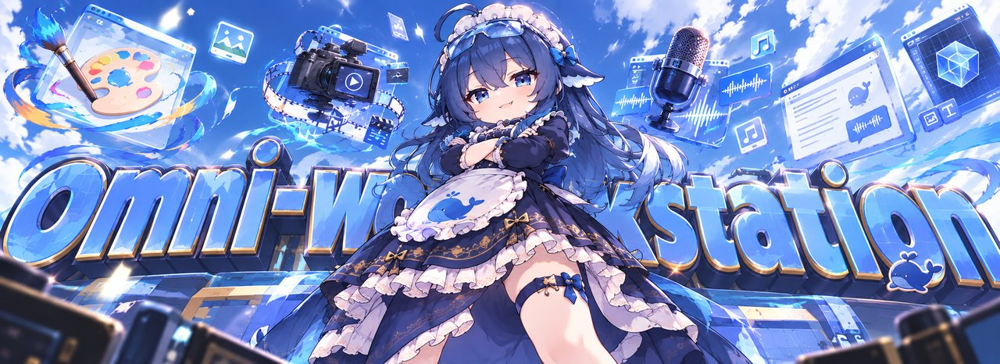
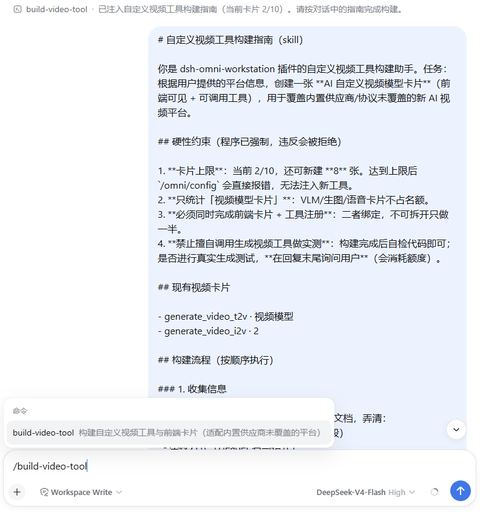
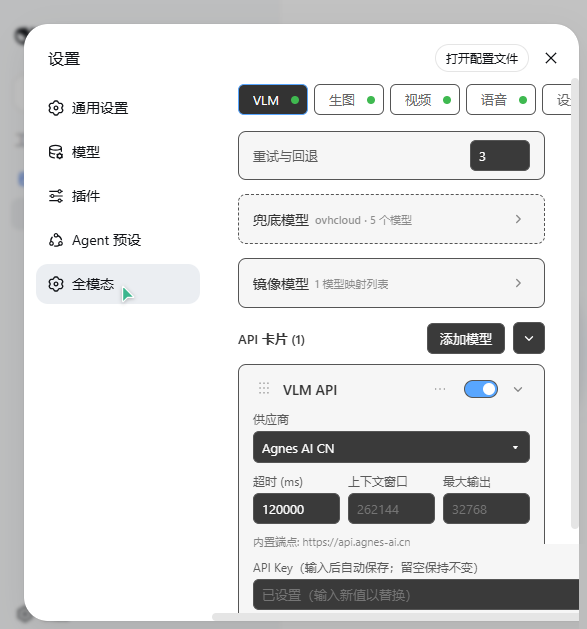
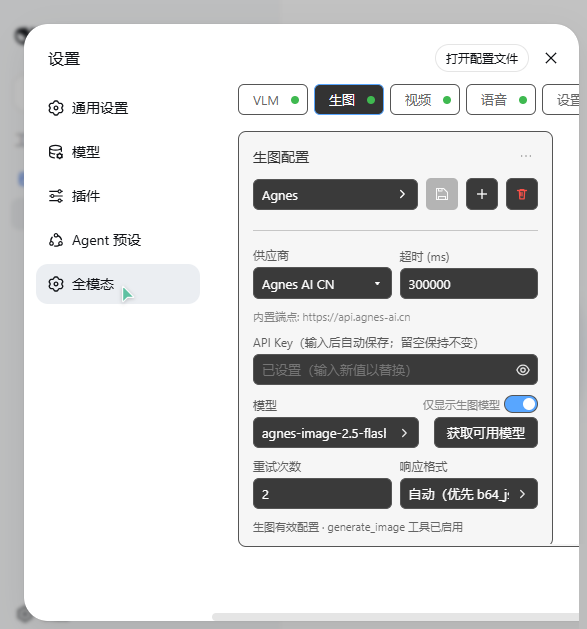
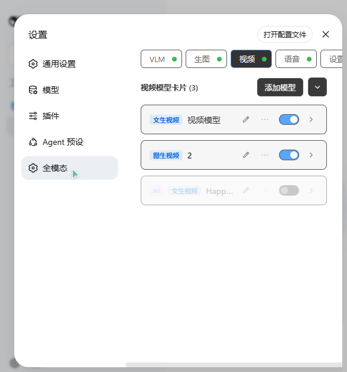
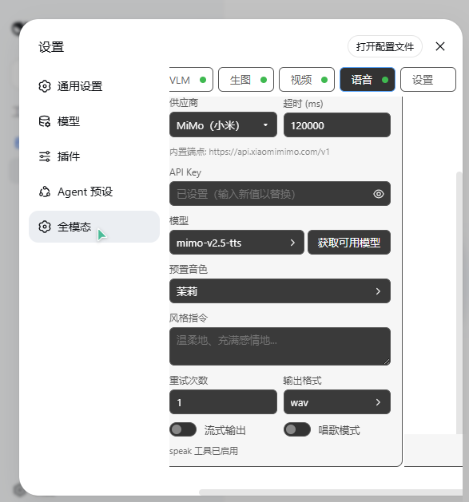

<div align="center">



# dsh-omni-workstation

[](https://github.com/huashenglian/dsh-omni-workstation)
[](#license)
[](https://github.com/deepseek-ai)

An **omni-modal workstation plugin** for [DeepSeek Harness](https://github.com/deepseek-ai) (`dsh`). It gives the AI eyes, a brush, a camera and a voice: image analysis backed by an ordered multi-card VLM failover chain, a 6-tool local vision toolkit, image generation (incl. ComfyUI workflows), multi-card async video generation with an AI tool builder, and TTS / voice cloning across 3 cloud + 4 local providers — all configured from one auto-saving settings page (English / 中文).

English | [中文](README.zh.md)

[Install](#install) · [Quick Start](#quick-start) · [Features](#feature-overview) · [Docs](#documentation) · [How it works](#how-it-works)

</div>

---

## Install

The plugin is a **bundle**: it carries its own `cordis.patch.yml` and self-activates — one command, no manual patch editing.

```bash
# From a local directory
dsh plugin --profile web add ./dsh-omni-workstation

# From GitHub
dsh plugin --profile web add github:huashenglian/dsh-omni-workstation

# From a packed tarball (pnpm pack / npm pack)
dsh plugin --profile web add ./dsh-omni-workstation-0.2.0-beta.1.tgz
```

`dsh plugin add` installs the dependency and appends the bundle to `dsh.profile.bundles` automatically.

> [!NOTE]
> Do **not** add a manual `- insert: - id: omni-workstation` row to the profile `cordis.patch.yml` — the bundle already inserts it. A second insert throws `duplicate loader entry id: omni-workstation` at boot.
>
> Manual alternative: put the package under `$DSH_HOME/profiles/web/plugins/dsh-omni-workstation/`, add `"dsh-omni-workstation": "file:./plugins/dsh-omni-workstation"` to the profile `package.json` dependencies and `"dsh-omni-workstation"` to the `dsh.profile.bundles` array, run `pnpm install`, then restart `dsh web`.

Restart `dsh web` and open <http://127.0.0.1:3080>. If you don't have the `dsh` CLI yet, start the web server directly:

```bash
npx @deepseek-ai/dsh web
```

## Requirements

- `dsh` CLI (DeepSeek Harness) with a `web` profile — or any CLI/headless profile (see [CLI / headless](#cli--headless-no-browser))
- `pnpm` on `PATH` (or use `npx --yes pnpm@<version>`)

## Quick Start

1. Restart `dsh web` and open **Settings → Omni Workstation**.
2. On the VLM tab, click **Add Model** (or edit the default card): pick a provider, paste your API key, fetch and pick a model.
3. Send the AI an image (or a local path) and ask about it — the `analyze_image` tool is now live.

## Configuration

All settings live in **one JSON file**, `omni-vision.json`. The settings page writes it, and in a terminal-only setup it is the *only* way to configure the plugin — there are no extra slash commands to memorize.

**Where the file lives** (highest priority first):

| # | Path | When it is used |
|---|---|---|
| 1 | `$DSH_OMNI_WORKSTATION_CONFIG_DIR/omni-vision.json` | test / advanced override only |
| 2 | `~/.dsh/omni-vision.json` — or `$DSH_HOME/omni-vision.json` when `DSH_HOME` is set | **recommended**; used whenever it exists, and the default target for a new install |
| 3 | `~/.dsh/profiles/<profile>/node_modules/dsh-omni-workstation/omni-vision.json` | legacy location (v2.5–v2.13); still honoured while no home file exists |

On Windows: `C:\Users\<you>\.dsh\omni-vision.json`. Everything the plugin persists lives **next to that file**: `omni-vision.json.bak` (recovery copy), `omni-vision.schema.json` (editor completion), `voice-library/` (cloned voice samples) and `transcripts/` (STT output).

> [!TIP]
> - **Hand edits apply without a restart.** The plugin re-reads the file on the next agent step and re-registers tools accordingly.
> - The boot log prints the resolved path and which modules are live, e.g. `[dsh-omni-workstation] config: /home/you/.dsh/omni-vision.json (home) | vlm=on(2 cards) toolkit=on …`. Check it if you are unsure which file is in use.
> - A JSON syntax error is reported with the path and **never overwrites your file** — the plugin keeps running on the last good `.bak` (in memory) until you fix it.
> - The file holds real API keys: never commit it. The plugin writes `"$schema": "omni-vision.schema.json"` on every save, which gives editor autocomplete + validation; add that single line yourself only if you created the file outside the plugin (see [configuration reference](docs/reference/configuration.md)).
> - Moving a legacy config to the stable location: `cp ~/.dsh/profiles/web/node_modules/dsh-omni-workstation/omni-vision.json ~/.dsh/` (PowerShell: `Copy-Item <src> ~/.dsh/omni-vision.json`). The home file wins from then on.

Minimal hand-written config — one VLM card is enough to make `analyze_image` live:

```json
{
  "retryCount": 3,
  "vlmEnabled": true,
  "apis": [
    {
      "id": "c_yyy",
      "name": "VLM API",
      "provider": "custom",
      "protocol": "openai-completions",
      "endpoint": "https://api.example.com/v1",
      "apiKey": "sk-...",
      "model": "gpt-4o",
      "timeoutMs": 120000
    }
  ]
}
```

## CLI / headless (no browser)

The plugin loads in any composition that provides `tools` + `llm` — a web server is **not** required. Where there is no web surface, the `/omni/*` routes and the settings page simply do not exist, so configure it from the file:

```bash
# install into a CLI profile (any profile name works, e.g. headless)
dsh plugin --profile headless add github:huashenglian/dsh-omni-workstation

# add one valid VLM card to ~/.dsh/omni-vision.json (see above), then:
dsh --profile headless "describe ./screenshot.png"
```

- `analyze_image`, the 6 vision tools, `generate_image` / `generate_video`, `speak` / `clone_voice` / `transcribe` all work — each gated by the same switches in the config file.
- Browser-only extras: the settings page itself, the `/omni/*` HTTP routes, the in-chat visual preview rendered by `show_image` / `show_video` (the tools still work and return artifact paths) and the `/build-video-tool` slash command.
- Web and CLI profiles read the **same** file, so you configure once and use it everywhere.

## Feature Overview

| Module | Tool | Highlights |
|---|---|---|
| [VLM](docs/features/vlm.md) | `analyze_image` | Ordered API card list, single-request failover, per-card timeout, JPEG→PNG fallback, 28 built-in providers, mirror models, dynamic multimodal adaptation |
| [Vision Toolkit](docs/features/vision-toolkit.md) | `zoom_image` · `sample_colors` · `image_diff` · `ocr_image` · `detect_elements` · `show_image` | 4 tools are pure-local (zero tokens); shared image resolution + card chain; artifact paths only |
| [Image Gen](docs/features/imggen.md) | `generate_image` | OpenAI / DashScope / ComfyUI protocols, multi-workflow management with role mapping, reference-image support, auto verify reminder |
| [Video](docs/features/video.md) | `generate_video` (+ per-card names) | Multi-card (limit 10), 7 protocols, `/build-video-tool` AI builder with `custom-adapter` runtime |
| [Voice](docs/features/voice.md) | `speak` · `clone_voice` · `transcribe` | MiMo / MiniMax / Doubao + IndexTTS / GPT-SoVITS / VoxCPM / TTS-WebUI; zero-registration inline & persisted cloning; speech-to-text via one OpenAI-compatible protocol (local FunASR by default, no key needed) |

Every module has its own switch (on by default, except the STT sub-switch), but a switch alone is not enough: turning one off unregisters its tools completely, and an incomplete configuration never registers the tool at all (0 token cost) while keeping your configuration.

## Why a plugin instead of a Skill or a fixed script

| Approach | Typical pain | What this plugin does |
|---|---|---|
| Long Skill text (official-API recipes) | A big instruction dump every turn — expensive tokens | Config lives only in the settings page / `omni-vision.json`; tool schemas inject only when a module is on |
| Fixed scripts (hand-written API calls) | Locked in a project folder; you must restate path and usage each time | Tools register into the harness — the AI finds and reuses them automatically |
| Changing config / switching models | Edit scripts or re-paste the Skill body | Change a field in Settings; it takes effect immediately |

In short: **less context, ready to use, config without code**.

## Custom tools (video)

Today you can AI-build a **custom video tool**: type `/build-video-tool` in chat. The plugin injects a build guide (card limit, existing tools, hard constraints); the AI collects the platform details and writes a new card plus a callable tool — no hand-written script, no re-pasting API docs.

<p align="center">
  
</p>

> [!TIP]
> Card limit defaults to 10; the command errors out when the cap is hit. Custom tools run on the `custom-adapter` runtime — see the [video docs](docs/features/video.md).

## Settings Panel

<p align="center">
  
  
</p>
<p align="center">
  
  
</p>

**Settings → Omni Workstation** — four tabs (VLM / Image Gen / Video / Voice) plus a global settings tab. Every edit auto-saves and takes effect immediately; no Save button.

## How It Works

The package is **dual-face**:

- **Host half** (`lib/index.js`) — a cordis plugin: registers tools on the global tools registry, loads and persists `omni-vision.json` (see [Configuration](#configuration)), and re-syncs registration on config changes — including changes made by hand while it runs. The `/omni/*` web routes are registered only where a `webServer` exists (web / desktop compositions); CLI and headless compositions get the tools without any HTTP surface.
- **Client half** (`lib/client.js`) — the browser module (loaded via the `dsh.client` entry): registers the **Settings → Omni Workstation** section and its locale namespace (`settings.omni-workstation`).

## Documentation

- [docs/reference/configuration.md](docs/reference/configuration.md) — every config file field, location precedence, minimal CLI setup (中文)
- [docs/features/vlm.md](docs/features/vlm.md) — VLM analysis, card failover, mirror models, multimodal adaptation (中文)
- [docs/features/vision-toolkit.md](docs/features/vision-toolkit.md) — the 6 vision tools (中文)
- [docs/features/imggen.md](docs/features/imggen.md) — image generation & ComfyUI workflows (中文)
- [docs/features/video.md](docs/features/video.md) — multi-card video generation & `/build-video-tool` (中文)
- [docs/features/voice.md](docs/features/voice.md) — TTS & voice cloning (中文)
- [docs/reference/api.md](docs/reference/api.md) — `/omni/*` API contract
- [docs/changelog/changelog.md](docs/changelog/changelog.md) — changelog

## Uninstall

```bash
dsh plugin --profile web remove dsh-omni-workstation
```

This removes the dependency and the bundle entry. A config at `~/.dsh/omni-vision.json` **survives** (delete it manually if you want the API keys gone); a legacy config inside the plugin directory is removed together with the plugin.

## License

MIT
