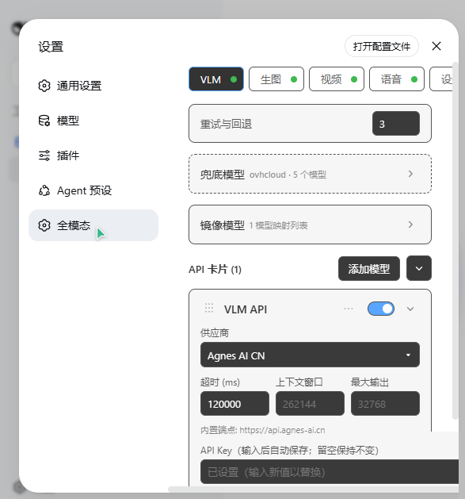

# VLM 图像与媒体分析（analyze_image / analyze_media）

> [English](../../README.md) | [返回功能索引](../../README.zh.md#功能总览)

VLM 模块为 AI 提供 `analyze_image` 与 `analyze_media` 两个工具：把本地图片、视频或音频（或用户上传的附件）交给视觉语言模型分析，回答关于其中内容的任何问题。底层是一张**有序 API 卡片列表**，支持单请求内自动回退、每卡独立超时与 JPEG→PNG 重编码兜底。

## 工具：analyze_image

| 参数 | 类型 | 必填 | 说明 |
|---|---|---|---|
| `image_path` | string | 二选一 | 图片本地路径（绝对路径，或相对当前工作目录） |
| `attachment_id` | string | 二选一 | 对话中上传图片的附件 id（形如 `sha256:...`）；两者同传时以此为准 |
| `question` | string | 是 | 分析需求，例如「这张图表反映了什么趋势？」 |

返回 `{ ok, answer, model, api, attempts, usage }`——回答文本、实际使用的模型与卡片、尝试次数。

**与原生视觉的关系**：若当前会话模型本身支持视觉输入（多模态模型），AI 会优先直接看图，仅失败时才回退 `analyze_image`（见下文「动态多模态适应」）；纯文本模型则固定使用本工具。

## 工具：analyze_media（视频 / 音频）

把视频或音频**直连卡片 API** 分析，绕过 harness 自身的 text/image 模态体系。

| 参数 | 类型 | 必填 | 说明 |
|---|---|---|---|
| `media_path` | string | 二选一 | 视频/音频本地路径（绝对路径，或相对当前工作目录） |
| `attachment_id` | string | 二选一 | 对话中上传文件的附件 id（形如 `sha256:...`）；两者同传时以此为准 |
| `question` | string | 是 | 分析需求，例如「这个视频里发生了什么？」「这段音频说了什么？」 |

返回 `{ ok, answer, model, api, attempts, usage }`。单个文件上限 64 MB。

**注册门控**：只有当至少一张卡片开启了 `video` 或 `audio` 模态时本工具才注册；全部关闭则**完全不注册（0 token）**，配置改动即刻生效。

**选路与回退**：

- 只尝试开启了所需模态的卡片，未开启的卡片**零次请求**。
- 单卡达 `retryCount` 上限后跳到下一张支持卡；支持卡全部失败则报错结束。
- **兜底模型（`fallbackConfig`）全程不参与**，未新增开关。

**协议形态**（实测）：

| 协议 | 视频 | 音频 |
|---|---|---|
| `openai-completions` | `image_url` + `data:video/...` 数据 URL | `input_audio { data, format }` |
| `google-gemini` | `inline_data` | `inline_data` |
| `openai-responses` / `anthropic-messages` | 未验证，跳过该卡 | 未验证，跳过该卡 |

> `openai-completions` 下**不要**使用 `video_url` 块：实测会被端点半途静默丢弃（响应仍是 200，但只有文本）。

## API 卡片（apis[]）

卡片按数组顺序自上而下调用；单次请求内某卡重试超限或遇不可恢复错误即回退下一卡；每次新请求重新从顶部开始。

| 字段 | 默认值 | 说明 |
|---|---|---|
| `name` | `VLM API` | 卡片显示名 |
| `provider` | `custom` | 供应商（见下表） |
| `protocol` | `openai-completions` | 协议：`openai-completions` / `openai-responses` / `anthropic-messages` / `google-gemini` |
| `endpoint` | 空 | 端点 URL（固定供应商内置只读） |
| `apiKey` | 空 | API Key（设置页回显掩码） |
| `model` | 空 | 模型名 |
| `timeoutMs` | `120000` | 每卡超时，钳制 [1000, 3600000]；超时立即中止并尝试下一卡 |
| `contextWindow` | 空（运行时 262144） | 上下文窗口 |
| `maxOutput` | 空（运行时 32768） | 最大输出 |
| `video` | `false` | 该卡片接受视频输入（`analyze_media` 用） |
| `audio` | `false` | 该卡片接受音频输入（`analyze_media` 用） |
| `enabled` | `true` | 卡片开关 |

两个模态开关只在卡片展开体内切换，默认关闭；关闭的卡片不会被 `analyze_media` 选中。旧配置缺这两个字段时自动按 `false` 处理。

全局 `retryCount`（默认 3，钳制 1–20）：单次请求内一张卡连续失败多少次后回退下一张。

## 内置固定供应商（28 家）

端点与协议内置只读，只需填 Key、模型与超时：

agnes · agnes-cn · anthropic · ant-ling · cerebras · fireworks · google · groq · huggingface · kimi-coding · minimax · minimax-cn · moonshotai · moonshotai-cn · nvidia · openai · openrouter · qwen-token-plan · qwen-token-plan-cn · together · vercel-ai-gateway · xai · xiaomi · xiaomi-token-plan-ams · xiaomi-token-plan-cn · xiaomi-token-plan-sgp · zai · zai-coding-cn

另有三类特殊供应商：`custom`（自定义端点，需 Key）、`ollama`（本地，免 Key）、`bailian`（阿里云百炼 DashScope 原生图像协议）。

## 兜底模型（fallbackConfig）

所有卡片都失败时的最后防线，走 OpenAI 兼容接口：

- `provider`：`ovhcloud`（内置免 Key 端点）
- `models[]`：有序模型列表（从上到下回退），默认预置 5 个模型
- `timeoutMs`：默认 `120000`

**v2.15 起兜底也算「已配置」**：`models` 非空时，即使 `apis[]` 里一张完整卡都没有，`analyze_image` 仍会注册（见下方「模块开关」）。

## 镜像模型（mirrorConfig）

把普通文本模型以「多模态条目」形式镜像进 /model 选择器，选定后走 VLM 卡片链看图：

| 字段 | 默认 | 说明 |
|---|---|---|
| `autoVisionEnabled` | `false` | `auto-vision` 自动路由条目——自动路由到最近使用的模型。**v2.15 起默认关闭**，需要在设置页手动打开（显式写 `true` 的旧配置保持开启） |
| `mirrorAllEnabled` | `false` | 镜像全部供应商为多模态条目（掩盖下方映射列表） |
| `mappings[]` | `[]` | 自定义映射：`{ originalProvider, originalModel, mirrorName }`，镜像名留空则用 `<原模型>-vision` |

## 动态多模态适应 + 原生视觉优先（v2.11.3 起；v2.17 起闸门改为开关）

`globalConfig.dynamicMultimodalAdapt`（默认开，设置 → 开关扩展 → VLM）决定「按当前模型能力自适应」：

- **开**：按当前对话模型是否声明图片输入（`inputModalities` 含 image）自适应——多模态模型直接看图（跳过 tool-result 图片 sanitize，生图验证提示用「必须立即视觉验证此图片…」）；纯文本模型固定 `analyze_image`。
- **关**：回到 v2.11.3 之前的旧行为（始终 `analyze_image` 路径）。

`globalConfig.nativeVisionGate`（**v2.17 新增，默认关**，设置 → 开关扩展 → VLM → 「原生视觉优先」）：

- **开启**（且动态适应开启、当前模型声明图片输入）时，`tools/pre-execute` 在派发前拦截 `analyze_image`，reason 为一句可执行的话：「analyze_image 未执行：当前模型可直接看图，请直接查看图片（或 read_image）。若你实际看不到图片，重试并传 native_vision_failed: true。」**不含插件机制术语**。
- 逃生口：`analyze_image(..., native_vision_failed: true)` 直接放行（模型实际看不到图、image 字段被错配到不支持图片的模型等）。
- **默认关**的原因：模型「声明支持图片」不等于「看得准」。像素素材、UI 细节、精确色值时，专用 VLM 往往明显更好；默认拦截会让这类任务拿不到更可靠的结论。
- 只针对 `analyze_image`——`zoom_image`/`sample_colors`/`image_diff`/`ocr_image`/`detect_elements` 没有原生视觉替代，始终可调。

**原生图片读取失败时的提醒**（v2.17）：`tools/post-execute` 监听原生 `read_image` 的失败结果，在 VLM 有效且动态适应开启时追加一句「若你看不到图片内容，改用 analyze_image（image_path 传同一路径）」。监听器任何异常都放行原结果。

**实现**：纯函数 `nativeVisionDenyReason(gate, dynamicAdapt, acceptsImages, toolName, args)` + `tools/pre-execute` 调用；`analyze_image.native_vision_failed: boolean` 仍为可选参数（无 `required` 键）。

## 插件提示词（v2.17）

`globalConfig.prompts` 存 5 个模块的提示词覆盖（`vlm` / `toolkit` / `imggen` / `video` / `voice`），留空表示用内置默认。设置页「插件提示词」卡片可逐条编辑、一键恢复默认。

注入方式：`systemPrompt.section({ name: 'omni:workstation', order: 2950, text: () => buildPromptText(liveCfg) })`——只拼接「已启用模块」的段落，全关则整段消失（0 token）；文本是 provider，面板保存后下一步即生效，无需重启。默认文案的控制点：不暴露插件内部机制、不重复工具 description、单条 ≤ 300 字。

## 回退与重试参数（globalConfig）

| 字段 | 默认 | 说明 |
|---|---|---|
| `backoffBase` / `backoffMax` | 800 / 5000 | 常规重试退避（ms） |
| `backoff429Base` / `backoff429Max` | 2000 / 10000 | 429 限流退避 |
| `retryStatusCodes` | `402,408,429,500,502,503,504,NET` | 触发重试的状态码 |
| `verifyReminder` | `false` | 生图后注入视觉验证提醒（默认关，需手动开启） |
| `dynamicMultimodalAdapt` | `true` | 见上节 |

JPEG→PNG 重编码兜底：服务端对 JPEG 载荷报 400/415 解码错误（如 llama.cpp `stb_image`）时，自动解码（内置 jpeg-js）重编码为 PNG 并同卡重试一次。

## 模块开关

`vlmEnabled`（默认开）**只决定上限**。`analyze_image` 真正注册的条件是以下之一：

- `apis[]` 里至少有一张完整卡片（`endpoint` + `model`，`custom` 还需 `apiKey`）；
- `fallbackConfig.models` 非空 **且** `fallbackConfig.enabled !== false`（兜底模型算「已配置」，直接用当前会话模型跑；开关关闭后这条通道失效）。

两者都不满足时不注册工具，schema 不进模型上下文（0 token）。`analyze_media` 另有条件：至少一张卡开启 `video` / `audio` 模态。关闭 `vlmEnabled` 则一律注销，配置完整保留。

## Related

- [视觉工具箱](vision-toolkit.md) —— 6 个辅助视觉工具与 `analyze_image` 共享卡片链
- [图像生成](imggen.md) —— 生图后的视觉验证提醒依赖本模块
