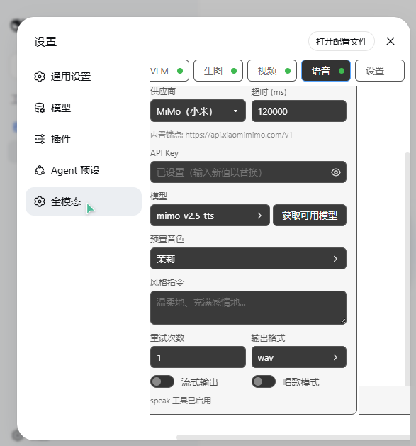

# 语音合成、音色克隆与语音转文字（speak / clone_voice / transcribe）

> [English](../../README.md) | [返回功能索引](../../README.zh.md#功能总览)

语音模块提供 `speak`（文本转语音）、`clone_voice`（音色克隆）与 `transcribe`（语音转文字）三个工具。TTS 侧支持 3 家云端供应商 + 4 个本地供应商动态注册；STT 侧 5 家共用一套 OpenAI 兼容协议。

- **TTS 门控**：`voiceEnabled === true && ttsEnabled === true && 配置有效`（默认关，关闭即 0 token）
- **STT 门控**：`voiceEnabled === true && sttEnabled === true && 配置有效`（默认关，关闭即 0 token）

## 供应商

| 供应商 | 类型 | 端点 | 说明 |
|---|---|---|---|
| `mimo` | 云端 | `https://api.xiaomimimo.com/v1` | 小米 MiMo TTS，OpenAI chat 兼容 |
| `minimax` | 云端 | `https://api.minimaxi.com` | MiniMax 海螺，`/v1/t2a_v2` |
| `doubao` | 云端 | `https://openspeech.bytedance.com` | 豆包 OpenSpeech，V1/V3 双区鉴权 |
| `indextts` | 本地 | `http://127.0.0.1:7880` | IndexTTS，`/api/v1/tts/tasks` |
| `gptsovits` | 本地 | `http://127.0.0.1:9880` | GPT-SoVITS，`/infer_classic` |
| `voxcpm` | 本地 | `http://127.0.0.1:8000` | VoxCPM，`/v1/audio/clone` \| `/v1/audio/design` |
| `tts-webui` | 本地 | 自定义 | OpenAI 兼容 `/v1/audio/speech` 桥接 |

另有 6 家纯预设下拉占位（openai-tts / elevenlabs / azure-tts / google-tts / dashscope / gemini-tts），执行时报错未接入。

**工具注册矩阵**：`speak` 在上述 7 家均注册；`clone_voice` 在 mimo / minimax / doubao / indextts / gptsovits / voxcpm（clone 模式）注册；`tts-webui` 不注册 `clone_voice`。

## 工具：speak

| 参数 | 类型 | 必填 | 说明 |
|---|---|---|---|
| `text` | string | 是 | 要合成的文本 |
| `voice` | string | | 音色：预置音色 ID（如 `mimo_default`/`茉莉`/`Chloe`）或音色描述文本（voicedesign）；minimax 下为 voice_id，doubao 下为 speaker_id，gptsovits/voxcpm 下为参考音频路径 |
| `voice_sample_path` | string | | 仅 mimo：`clone_voice` 返回的参考音频路径，传入后用克隆音色合成 |
| `style` | string | | 自然语言风格指令（如「温柔但疲惫，语速偏慢」），支持 `(唱歌)` 标签 |
| `output_dir` | string | | 保存目录；不指定则保存到 `<工作区>/.omni-workstation/audio/` |

返回 `{ ok, path, model, format, detail }`。

**MiMo 3 模型**：`mimo-v2.5-tts`（预置音色，含唱歌）/ `mimo-v2.5-tts-voicedesign`（文本设计音色）/ `mimo-v2.5-tts-voiceclone`（音色复刻，传 `voice_sample_path` 时自动切换）。预置音色 9 个：`mimo_default`、冰糖、茉莉、苏打、白桦、Mia、Chloe、Milo、Dean。

## 工具：clone_voice

| 参数 | 类型 | 说明 |
|---|---|---|
| `voice_sample_path` | string | 参考音频本地路径（doubao 不填时用面板预设路径；mimo/minimax 必填） |
| `voice_id` | string | 自定义音色 id（doubao 不填时用预设 speaker_id） |
| `app_id` / `access_key` | string | 仅 doubao：覆盖面板凭据 |
| `text` | string | 试听文本（可选，传了返回 demo_audio） |

各供应商行为：

- **mimo**：确认采样路径 → 后续 `speak` 传 `voice_sample_path` 复用（每次合成内联克隆）。
- **minimax**：上传参考音频（`/v1/files/upload` → `/v1/voice_clone`）注册持久 voice_id → `speak(voice=...)` 复用。
- **doubao**：V1 API 声音复刻（`/api/v1/mega_tts/audio/upload`，音频需 ≥5s）异步训练 → speaker_id → `speak(voice=...)` 复用；复刻区与生成区各自独立协议（V1 App ID+Access Token / V3 KEY）与凭据，命中复刻音色自动用 ICL 模型。
- **indextts / voxcpm**：上传到后端返回音色名/路径 → `speak(voice=...)` 复用。
- **gptsovits**：确认参考音频路径即可（每次合成自动使用，无需独立克隆 API）。

## 配置（voiceConfig）

| 字段 | 默认 | 说明 |
|---|---|---|
| `provider` / `protocol` / `endpoint` | `mimo` / `mimo-tts` / 内置 | 供应商（协议与端点固定） |
| `apiKey` | 空 | 鉴权 Key（doubao 双区：`appId`+`accessKey` 或 `apiKey`） |
| `model` | 空 | 模型（indextts/voxcpm 填 `default`） |
| `voiceId` | `mimo_default` | 默认音色 |
| `timeoutMs` | `120000` | 超时 |
| `styleInstruction` | 空 | 风格指令（面板默认值） |
| `singMode` / `optimizeText` | `false` | 唱歌模式 / 文本优化 |
| `outputFormat` | `wav` | 输出格式（`wav` / `pcm16`） |
| `streamOutput` | `false` | 流式输出 |
| `retryCount` | `1` | 重试 |
| `region` / `apiVersion` | `cn` / `v1` | minimax 区域 / doubao API 版本 |
| `gptModel` / `sovitsModel` / `refAudioPath` / `refText` / `promptLang` / `textLang` | 空/`中文` | GPT-SoVITS 专有 |
| `mode` | `clone` | voxcpm 模式（`clone` / `design`） |

另有：`voicePresets[]`（TTS 预设栏，手动保存快照）、`voiceConfigStt` + `voicePresetsStt`（STT 子页：配置与预设栏，结构见下节）、`voiceLibrary[]`（参考音频库，存 `<配置目录>/voice-library/`）、`doubaoClonePresets[]`（豆包复刻预设：speakerId/refAudioPath/cloneModel/appId/accessToken/apiKey/apiVersion，跨语音预设共享）。

**克隆路由**：`POST /omni/minimax/clone`、`/omni/doubao/clone`、`/omni/indextts/clone`、`/omni/voxcpm/clone`（面板与工具共用）。

## 语音转文字（transcribe）

把音频/录音转成文字。门控 `voiceEnabled === true && sttEnabled === true && isSttConfigValid(voiceConfigStt)`，**默认关闭**——关闭或配置无效时工具完全不注册（schema 不注入，0 token）。

### 供应商

5 家共用一套协议：`POST {endpoint}/audio/transcriptions`（multipart，`file` + `model`，可选 `language` / `prompt` = 热词）。默认 `funasr`（本机跑 FunASR 即可零配置、无需 Key）。

| 供应商 | 端点 | 需要 Key | 内置模型 | 大小上限 |
|---|---|---|---|---|
| `openai` | `https://api.openai.com/v1` | 是 | `gpt-4o-transcribe` / `gpt-4o-mini-transcribe` / `whisper-1` | 25MB |
| `groq` | `https://api.groq.com/openai/v1` | 是 | `whisper-large-v3-turbo` / `whisper-large-v3` | 25MB |
| `siliconflow` | `https://api.siliconflow.cn/v1` | 是 | `FunAudioLLM/SenseVoiceSmall` / `TeleAI/TeleSpeechASR` | 50MB |
| `funasr` | `http://127.0.0.1:8000/v1` | 否 | `sensevoice` | 无限制（安全上限 64MB） |
| `custom` | 自填（任意 OpenAI 兼容端点） | 否 | 空（自己填/获取） | 无限制（安全上限 64MB） |

### 工具：transcribe

| 参数 | 类型 | 必填 | 说明 |
|---|---|---|---|
| `audio_path` | string | 二选一 | 音频本地路径（绝对路径或相对当前工作目录） |
| `attachment_id` | string | 二选一 | 对话中上传音频的附件 id（形如 `sha256:...`）；同时给出时以它为准 |
| `language` | string | | 覆盖面板识别语言（如 `zh` / `en` / `ja`）；留空用面板配置 |
| `hotwords` | string | | 覆盖面板热词/提示词（专有名词、人名等，空格分隔）；留空用面板配置 |

返回 `{ ok, text, language, duration, filePath, segments, detail }`——**只返回文本**（工具结果不会出现音频块）。`transcribe` 只做转写，不理解/总结音频内容，拿到文字后由模型自己作答。

### 输出样式（面板设置）

| `outputMode` | 行为 |
|---|---|
| `text`（默认） | 纯文字 |
| `timestamps` | 带时间戳（`segments[]`） |
| `srt` | 字幕文件 `.srt`，同时返回文本 |
| `vtt` | 字幕文件 `.vtt`，同时返回文本 |

`srt` / `vtt` 落盘到 `<工作区>/.omni-workstation/transcripts/`。

### 与 analyze_media 的冲突规则

**STT 有效时，音频转写一律走 `transcribe`**，VLM 音频通道被三层接管：

1. `analyze_media` 工具描述改写为「仅处理视频分析，不要用本工具处理音频」；
2. `tools/pre-execute` 在调用发出**之前**拦截 `analyze_media` 的音频请求（deny + 指路 `transcribe`，不浪费任何一次 VLM 请求）；
3. `askMedia` 兜底拦截——即使绕过前两层，音频请求也会抛错。

**视频通道不受影响**：`analyze_media` 处理视频的行为完全不变。STT 关闭（或配置无效）时，三层拦截全部失效，一切恢复原行为。

### 配置（voiceConfigStt）

| 字段 | 默认 | 说明 |
|---|---|---|
| `provider` / `protocol` | `funasr` / `openai-stt` | 供应商（协议统一 `openai-stt`） |
| `endpoint` | `http://127.0.0.1:8000/v1` | 端点（前 4 家固定不可改，`custom` 可填） |
| `apiKey` | 空 | 鉴权 Key（`keyRequired` 供应商必填） |
| `model` | `sensevoice` | 模型（必填，可点「获取」拉取） |
| `language` | 空（自动） | 识别语言代码 |
| `hotwords` | 空 | 热词/提示词（走 multipart `prompt` 字段） |
| `outputMode` | `text` | `text` / `timestamps` / `srt` / `vtt` |
| `timeoutMs` / `retryCount` | `120000` / `1` | 超时；重试（= **总尝试次数**，仅网络错误 / 429 / 5xx 重试） |
| `extraParams` | 空 | 附加参数 JSON，展开成 multipart 字段 |

**面板**：语音 tab → STT 子页，表单含供应商 / 端点 / Key（眼睛按钮查看）/ 模型（+获取）/ 输出样式；「高级选项」默认折叠，内含语言 / 热词 / 超时 / 重试次数 / 附加参数 JSON 框。另有「试一下」区：选本地音频文件或用麦克风录音，当场显示转写结果（音频仅在内存中以 base64 传输，麦克风录音不落磁盘）。

**超限与不支持格式**：超过供应商大小上限、或扩展名/内容嗅探判定为不支持的格式时**直接报错并给出建议**（如「先压缩或切片，或改用本地 FunASR」），**不会自动切片或转码**。

## Related

- [README 功能索引](../../README.zh.md#功能总览)
